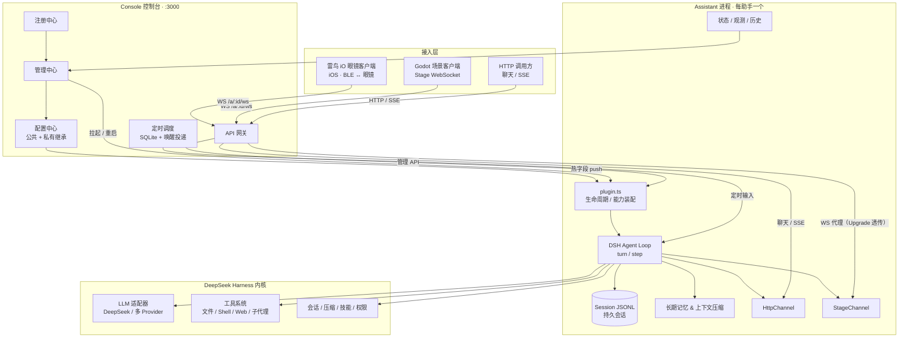

# Bean Assistant · 豆子助手

> **基于 DeepSeek Harness 内核构建的数字人 Agent 平台**：每个助手是独立进程，拥有自己的 Agent、持久会话、长期记忆与场景能力；控制台统一完成注册、管理与配置下发。

[](https://nodejs.org)
[](https://www.typescriptlang.org)
[](https://godotengine.org)
[](#自动化验证)
[](./LICENSE)

Bean Assistant 把「大模型能力」变成「可运营的数字人」：内核负责 Agent 循环、LLM 接入、工具与会话，业务层负责把每个助手当作独立服务来注册、配置、观测与升级。控制台是唯一的配置与调度中枢，助手进程只做一件事——让一个 Agent 在自己的会话里持续、可靠地活着。

Stage 侧目前有两类正式客户端：**Godot 场景客户端**与**雷鸟 iO 眼镜客户端**，共用同一套连接、注册、激活与命令回执协议（见 [客户端接入约定](docs/clients.md)）。

---

## 为什么是 Bean Assistant

| 常见做法 | Bean Assistant |
| --- | --- |
| 单进程里塞多个"角色"，上下文互相污染 | **一助手一进程**：独立 Agent、独立 Session、独立凭证与记忆目录，互不影响 |
| 模型、人设、密钥硬编码在代码里 | **配置中心驱动**：provider / model / apiKey / skills 热切换，persona / 指令冷切换 |
| 只能聊天，接不进游戏或可穿戴设备 | **双通道 + 双客户端**：HTTP + SSE 面向普通聊天；Stage WebSocket 同时服务 Godot 场景客户端与雷鸟 iO 眼镜客户端 |
| 重启即失忆，压缩即丢上下文 | **持久会话 + 长期记忆**：JSONL 追加日志、摘要与精细记忆、压缩后上下文重投影 |
| 内核升级靠"感觉" | **可验证升级**：锁定内核版本 + 62 项自动化回归 + 依赖版本巡检，一条命令验证 |

## 架构一览



所有外部请求统一从 **Console 网关**进入：网关校验平台 API Key 后，把 `/a/{sessionId}/...` 代理到对应助手的内部端口——管理 API、HttpChannel、StageChannel 三个监听器都只在内网可达，客户端不直连。WebSocket 由网关在 `upgrade` 事件上完成鉴权与双向透传（`/a/{sessionId}/ws` → 助手 StageChannel `/ws`）。

三条边界清晰的平面：

- **控制面**（Console）：注册、管理、配置、调度、网关；所有助手的"身份证"和"遥控器"。
- **数据面**（Assistant）：管理 HTTP、聊天 HTTP/SSE、Stage WebSocket 三个**内部**端口，经 `channelEndpoints` 上报给控制台供网关转发。
- **场景面**（Stage）：Godot 与雷鸟 iO 眼镜客户端先 `hello`、再注册环境、显式激活；助手通过 Bridge 下发命令，客户端回执结果。注册 ≠ 激活，断线可恢复。

## 核心能力

- **多助手隔离**：每助手独立进程、Session、记忆、凭证与 agentMd；控制台进程崩溃后可由 launchd 守护拉起。
- **配置中心**：公共配置 + 助手私有覆盖，热/冷字段分级生效，改完即生效或手动重启生效。
- **场景化交互**：Stage 注册 / 激活 / 转移协议、Bridge 命令回执、动态上下文快照去重与压缩恢复；Godot 与雷鸟 iO 眼镜共用同一套协议，服务端无需为客户端分叉。
- **长期记忆**：摘要记忆 + 精细记忆，带原文范围溯源；召回注入去重，压缩期间消息排队。
- **自动化调度**：once / interval / daily 任务，离线重试、重启恢复、错过区间合并、手动历史独立记录。
- **可观测**：`/api/status`、`/api/observability`、历史与附件下载，SSE + 事件中心双通道。
- **内核可升级**：`kernel-pin.json` 锁定内核提交，升级前后用自动化脚本做版本巡检与全量回归。

## 仓库结构

```
bean-assistant/
├── console/            # 控制台：注册中心 · 管理中心 · 配置中心 · 网关 · 调度
├── assistant/          # 助手进程：Cordis 插件树 + 一个 dsh Agent + 三通道服务
├── assistant-godot/    # Godot 场景客户端「萤火镇」（Stage 协议消费者）
├── automation/         # 自动化验证：类型检查 · 测试 · 依赖巡检 · 内核升级
├── docs/               # 架构、协议、配置中心、调度、记忆等设计文档
└── README.md
```

> 雷鸟 iO 眼镜客户端（iOS / SwiftUI）位于同级目录 `glasses/RayNeoCustomApp`，是独立 Xcode 工程；它通过同一套 Stage 协议接入，不依赖本仓库的 dsh 内核。

## 快速开始

前置：Node.js ≥ 22、pnpm 11、同级的 [deepseek-harness](https://github.com/deepseek-ai/deepseek-harness) 内核仓库；Godot 4（Godot 客户端需要）、Xcode（雷鸟 iO 眼镜客户端需要）。

```bash
# 1. 建立/检查内核依赖链接
node automation/setup-links.mjs --check

# 2. 一键回归：类型检查 + assistant 49 项 + console 13 项
node automation/verify.mjs

# 3. 启动控制台（:3000）
cd console && npm start

# 4. 以指定身份启动一个助手
cd assistant && npm run dev -- \
  --name "我的助手" \
  --console-url http://127.0.0.1:3000 \
  --provider <provider> --model <model> \
  --session-id <稳定会话ID> --port 3001
```

完整启动参数、端口语义与协议细节见 [docs/development.md](docs/development.md)、[docs/architecture.md](docs/architecture.md)、[docs/protocol.md](docs/protocol.md)。

## 自动化验证

`automation/` 是升级依赖时的"安全带"：

```bash
node automation/verify.mjs          # 安全扫描 + 类型检查 + 全部测试 + 基线比对
node automation/check-secrets.mjs   # 密钥 / 私钥 / 敏感文件 / 本机路径扫描
node automation/check-updates.mjs   # 内核 / vendor / 第三方版本巡检
node automation/setup-links.mjs     # 依赖链接重建（换机器 / 换内核）
```

- 测试自动发现，新增用例不会漏跑；通过数低于基线会判定为疑似回归。
- 默认先跑安全扫描：拦截密钥、私钥、`.env`/证书/数据库等敏感文件，以及本机用户目录与设备 UDID。
- 版本巡检同时展示 npm `latest` / `next` / `alpha`，区分候选升级线与退役版本线。
- 全部脚本零第三方依赖、支持 `--json`，可接入任意流水线。

内核升级流程（详见 [automation/README.md](automation/README.md)）：

```bash
node automation/check-updates.mjs                     # 1. 看新版本
node automation/setup-links.mjs --apply --kernel <新内核>  # 2. 切换内核
node automation/verify.mjs                            # 3. 回归验证
# 4. 通过后更新 automation/kernel-pin.json 的 commit / version / baselines
```

## 技术栈

| 层 | 选型 |
| --- | --- |
| 语言 / 运行时 | TypeScript · Node.js ≥ 22 |
| Agent 内核 | [DeepSeek Harness](https://github.com/deepseek-ai/deepseek-harness)（cordis 插件框架 · agent-loop · session） |
| 进程间协议 | HTTP · SSE · WebSocket |
| 控制台存储 | JSON 文件 · SQLite（调度 / 会话检索） |
| 客户端 | Godot 4（GDScript） · iOS SwiftUI / RayNeoKit（雷鸟 iO 眼镜） |
| 测试 | Node.js 内置 test runner + tsx · 自研 automation 工具链 |

## 文档

- [架构设计](docs/architecture.md) · [进程间协议](docs/protocol.md) · [Stage 客户端接入](docs/clients.md)
- [配置中心](docs/config-center.md) · [定时调度](docs/task-scheduler.md)
- [长期记忆与压缩验证](docs/memory-verification.md) · [网络搜索](docs/network-search.md)
- [开发指南](docs/development.md) · [守护进程](docs/守护进程.md)
- [自动化验证](automation/README.md)

## 项目状态

| 模块 | 状态 |
| --- | --- |
| `console/` 控制台 | 可用 · 13 项测试 |
| `assistant/` 助手进程 | 可用 · 49 项测试 |
| `assistant-godot/` Godot 场景客户端 | 开发中 |
| `glasses/RayNeoCustomApp` 雷鸟 iO 眼镜客户端 | 独立工程 · Swift 单测 |
| `automation/` 自动化验证 | 可用 · 62 项回归 |

## 安全

- 仓库不包含密钥、私钥与运行时数据：`data/`、`node_modules/`、构建产物、`.env`、证书、`*.sqlite`、`*.ipa` 等均在 `.gitignore` 中。
- 提交前运行 `node automation/check-secrets.mjs`（`verify.mjs` 默认包含）；发现真实密钥时先吊销再清理历史。
- GitHub Secret Scanning 与 Push Protection 已在本仓库开启，推送含已知供应商密钥的提交会被拦截。
- 客户端 API Key 只保存在本机（Godot `user://config.json` / iOS Keychain），不进入仓库；文档中的 `ask_xxxxxxxx` 均为占位符。

## License

[MIT](./LICENSE)

---

<p align="center"><sub>Bean Assistant — 让每个数字人都拥有自己的记忆、场景与可编排的一生。</sub></p>
