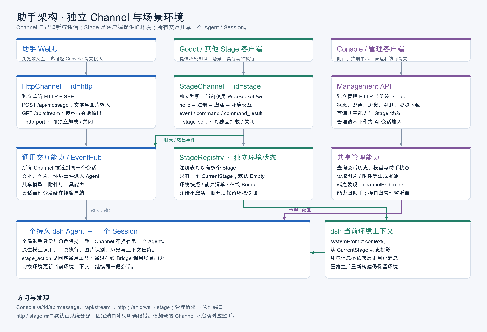

# AI 助手平台架构

每个助手是独立进程，运行由原生 `agent-loop` 创建/恢复的一个 dsh Agent 和一个持久 Session。控制台是注册、管理和配置中心。

## 端口与边界

管理 API 使用 `config.port`；`HttpChannel`（id `http`）使用 `httpPort`，提供普通聊天 HTTP 和 SSE；`StageChannel`（id `stage`）使用 `stagePort`，提供 `/ws` WebSocket。后两者默认端口为 `0`，由系统分配。管理 API 不承载聊天、SSE 或 Stage transition；配置、状态、历史、下载等管理请求上游访问管理端口，控制台网关自身仍监听 console 端口。

启动默认 `--channels http,stage`，助手注册请求与 `/api/status` 包含 `channelEndpoints`（id、protocol、host、port、path）。控制台网关管理请求使用管理端口，聊天/SSE 使用 http，Stage 客户端连接 stage 的 `/ws`（`/a/:id/ws` 映射到该路径）。旧 ws、vn、ai-town、webui、web-ui 仅作兼容别名。新配置 `channels: []` 只启动管理 API；`channels: ["stage"]` 只启动场景交互，HTTP 会话不会隐式开启。

## 组件

- `plugin.ts` 获取原生 `agent-loop` 创建/恢复的 Agent，装配 StageRegistry、能力服务，并启动三个监听器。
- HttpChannel 处理 `POST /api/message` 与 `GET /api/stream`。
- StageChannel 面向 Godot、雷鸟 iO 眼镜（iOS）等具备场景能力的客户端，处理 hello、stage_register、activate、events、Bridge 命令结果和聊天输出。公网部署统一经 Console 网关接入，独立部署可使用手动 WS 直连。
- StageRegistry 独立管理注册表与唯一 CurrentStage；注册不等于激活。单 Agent/Session 设计不变。
- 原 AiTown、WebUI、WSChannel 已取消。

普通聊天经 http 投递到唯一 Session 并经 SSE 订阅。Stage 客户端先 hello，再注册环境，按需激活；助手通过 Bridge 发 command，客户端以 command_result 回执。重启后 Stage 等待客户端重新连接注册。动态 Stage 上下文遵循快照去重和缓存策略：内容未改变且仍在有效上下文中时不重复追加，压缩后在下一次模型请求前恢复完整快照；断线时通信句柄失效，恢复连接后重新注册并激活，不重复写入未变化上下文。事件观测由事件中心广播给 SSE 和 `llm_event`，status、observability、history 和下载仍属管理 API。
