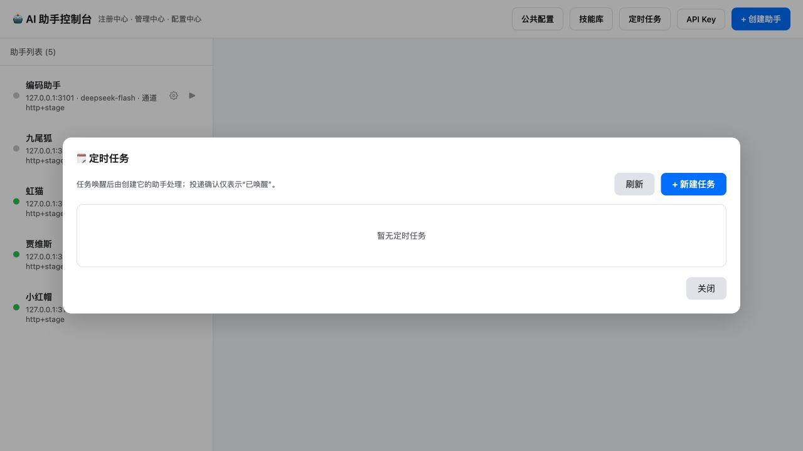

# 定时任务

定时任务由 Console 统一保存和调度，到期时向**创建它的助手会话**投递一个「定时任务触发」系统事件。它适合提醒、定期检查和需要助手在某个时间继续处理的工作。

Console 需要持续运行。任务数据位于 `~/.assistant/console/scheduler.sqlite`，使用 Node 内置 `node:sqlite`；建议使用 Node 24（最低需要 Node 22.13）。

## 使用方式

在 Console 页面右上角打开「定时任务」。这里可以查看所有任务，按助手创建任务，并编辑标题、提示词和调度；创建人固定为所选助手，之后不能更改。离线助手也可以创建任务，但离线期间不会被 Console 自动拉起。

每个任务的状态会显示下次运行、最近投递结果与错误。可在页面中暂停或恢复、立即唤醒、删除任务，并查看运行历史。一次任务成功投递后会自动暂停并标记完成。

助手也可以通过以下工具管理自己的任务：

- `create_scheduled_task`：创建任务。
- `list_scheduled_tasks`：列出自己创建的任务。
- `update_scheduled_task`：修改标题、提示词、调度或 `enabled` 状态。
- `delete_scheduled_task`：删除任务。
- `scheduled_task_runs`：查看自己任务的投递记录。

助手工具会把创建人自动绑定到当前会话，不能读取或修改其他助手的任务。

## 调度格式

`schedule` 必须是以下三种之一：

```json
{ "kind": "once", "at": "2026-10-12T09:30:00+08:00" }
```

单次任务的 `at` 必须是带明确时区偏移的 ISO 时间（例如 `Z` 或 `+08:00`）。

```json
{ "kind": "interval", "everySeconds": 3600, "startAt": "2026-10-12T09:00:00+08:00" }
```

间隔任务的 `everySeconds` 必须为不少于 60 的整数；`startAt` 可省略，省略时从创建后的一个间隔开始。

```json
{ "kind": "daily", "time": "09:30", "timezone": "Asia/Shanghai" }
```

每日任务使用 24 小时制 `HH:mm` 和 IANA 时区。Console 界面预填 `Asia/Shanghai`；API 和助手工具的每日计划需要明确填写 `timezone`，也可以使用其他有效 IANA 时区。夏令时切换导致指定当地时间不存在时，跳过该日。

## Console API

Console 管理 API 使用平台 API Key。未传 `creatorSessionId` 查询参数时，Console API 可全局查看和管理任务；助手工具会附带该参数，因此只作用于当前助手。

创建任务：

```bash
curl -X POST http://127.0.0.1:3000/api/scheduled-tasks \
  -H 'Authorization: Bearer <platform-api-key>' \
  -H 'Content-Type: application/json' \
  -d '{
    "creatorSessionId":"assistant-12345678",
    "title":"每日检查",
    "prompt":"检查待办事项并汇报异常。",
    "schedule":{"kind":"daily","time":"09:30","timezone":"Asia/Shanghai"}
  }'
```

常用端点如下。列表和运行历史返回 `{ "count": number, "items": [...] }`；创建、读取和更新返回任务对象；立即唤醒返回运行对象并使用 `202`；删除返回 `{ "deleted": true }`。

| 方法 | 路径 | 说明 |
| --- | --- | --- |
| `GET` | `/api/scheduled-tasks` | 列出任务；可加 `?creatorSessionId=<sessionId>` 限定创建人。 |
| `POST` | `/api/scheduled-tasks` | 创建，body 为 `creatorSessionId`、`title`、`prompt`、`schedule`。 |
| `GET` | `/api/scheduled-tasks/:id` | 读取一个任务。 |
| `PATCH` | `/api/scheduled-tasks/:id` | 修改 `title`、`prompt`、`schedule`、`enabled` 中的一项或多项。 |
| `DELETE` | `/api/scheduled-tasks/:id` | 删除任务及后续调度。 |
| `POST` | `/api/scheduled-tasks/:id/run` | 立即创建一次手动唤醒。 |
| `GET` | `/api/scheduled-tasks/:id/runs` | 查看运行历史。 |

任务对象包含 `id`、`ownerSessionId`、`creatorName`、`title`、`prompt`、`schedule`、`enabled`、`nextRunAt`、`lastOutcome`、`lastError`、`createdAt`、`updatedAt` 与 `completedAt`。运行对象包含触发来源（`scheduled` 或 `manual`）、投递状态、尝试次数、各次时间和最后错误。

## 投递语义与边界

### 给助手的事件上下文

定时通知不是用户刚刚发送的新消息。其来源为 `source.kind: system-event`、`producer: console.scheduler`、`eventType: scheduled-task-triggered`，使用 DSH 的 `form: notice` 标记。模型可见内容明确写出「系统事件：定时任务触发」，包含：

- `task`：触发时的完整任务快照，包括原始 `prompt`、任务名称和 ID、创建助手名称和会话 ID、调度配置、创建/更新时间及当时状态。
- `run`：本次运行 ID、自动到期或手动唤醒、计划时间、实际触发时间。

每次创建运行记录时，Console 将任务快照存入 SQLite 的 `runs.task_snapshot_json`。后续修改原任务不会改变已经创建的运行上下文；重试继续使用同一快照和运行 ID。

这与 Godot 的场景事件属于同一类外部事件输入，共用助手的输入队列与压缩门控；Godot 来源保持 `stage-event`，调度器来源为 `system-event`。两者有不同的事件负载与来源，不能互相冒充。

DSH 原生队列和会话日志目前使用 `UserMessage` / `user/message` 作为通用上下文容器，运行时通知也由该容器承载。因此本改动不修改 LLM 协议的 `role`，也不把任务写进长期 system prompt；事件语义通过明确的来源、通知标记和模型可见内容表达。Console 的实时输出和历史回放均显示为系统事件卡片，记忆原文也记录为 `system-event`。

旧版待处理 receipt 仍可恢复为系统事件；缺失的旧任务快照和实际触发时间会明确标为未知，不编造信息。旧运行记录首次恢复投递时，会保存当时可获得的任务快照。

Console 每次到期创建一条运行记录。同一任务同一时刻只会有一个投递在进行；助手离线或接口暂时失败时，保留同一个 `runId`，默认每 5 秒重试。助手重新上线后，仍会向原来的 `ownerSessionId` 投递。

`delivered` 和 UI 中的“已唤醒”只表示助手已经持久确认接收输入，不表示 LLM 已完成提示词中的工作。助手忙碌时输入会排队；在会话压缩期间，投递也会经过同一套门控，避免绕过会话生命周期。

助手在确认前会写入待处理 receipt；重启后会恢复未消费的输入，并以 `runId` 去重。该机制避免常见的重复投递和丢失，但不承诺外部副作用的 exactly-once：提示词若触发网络写入、发送消息等操作，仍应由任务内容或目标系统自行保证幂等。

系统不会自动启动离线助手，也不会为错过的间隔任务逐次补齐。恢复后先投递保留的一次运行，再跳到下一个未来调度时间，避免离线时间较长后产生大量补跑请求。删除任务不能撤回已经投递给助手的输入。

## 权限

本项目启动的助手使用 `danger-full-access` 与 `approval: never`；该设置对新建和恢复的会话都生效，工具操作不再经过 DSH 的只读限制和人工批准。它是本项目助手进程的权限配置，定时任务本身不额外授予权限。

## 验证记录

- 助手回归测试 49 项通过；Console 回归测试 13 项通过；两个项目 TypeScript 检查通过。
- 原生 DSH 模拟模型请求确认包含系统事件标记、原始 prompt、完整任务快照和本次运行信息；记忆原文分类为 `system-event`。实时事件转换与历史来源兼容均有回归验证。
- 已部署系统事件版本并迁移生产 SQLite；两个既有任务的内容、创建助手与调度时间均保持不变，三个原在线助手恢复原会话。
- 使用管理页面创建临时任务，确认创建人显示为虹猫的固定会话；随后清理该任务。
- 运行中的 Console 使用本地模拟接收器完成一次实际到期调度：SQLite 保存任务、运行状态变为 `delivered`、只向目标会话投递一次、单次任务自动停用。模拟任务和注册项均已清理。
- 已重启 Console，并恢复原先在线的虹猫、贾维斯、小红帽；三者 `/api/status` 均返回 `danger-full-access` / `never`，会话 ID 保持一致。
- 尚未向真实助手投递测试提示词：自动审批拒绝了该次操作，原因是会触发真实模型调用、写入会话历史并可能产生费用。当前验证使用本地模拟接收器，不代表已验证真实模型执行任务的完成结果。


